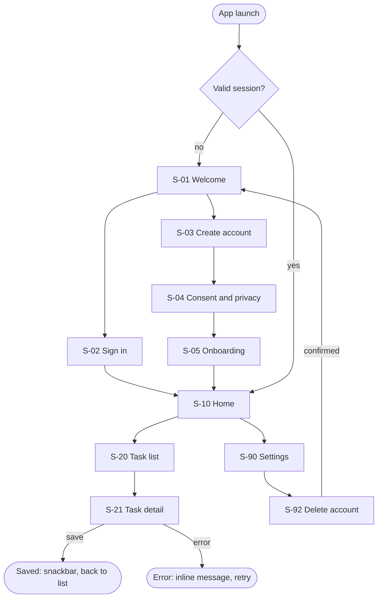

# App flow and screen inventory

Build the flow before any screen exists. The flow is the contract the UI, navigation, and tests
follow.

## Shape

Entry point → authentication or onboarding → main navigation → feature screens → actions →
success and error states.

Cover the paths users actually hit, not only the happy path:

- First launch, returning user, signed-out user, expired session.
- Deep link on cold start and warm start (including to a protected screen while signed out).
- Offline at launch and offline mid-flow.
- Permission requested, denied, permanently denied, revoked in Settings.
- Account deletion and sign-out from anywhere they are offered.
- Update required (a backend-forced minimum version), maintenance, or server error.

## Mermaid example

Keep one diagram per area when the app is large; link them by screen ID.

## Screen inventory fields

| Field | Content |
|---|---|
| Screen ID and name | `S-21 Task detail` |
| Purpose | One sentence |
| Entry points | Routes, deep links, notifications that open it |
| Exits and destinations | Where each action leads; results returned |
| User actions | Each action and its outcome |
| State dependencies | State owner(s) it reads and the intents it sends |
| API / repository dependencies | Repository methods and endpoints |
| States | Loading · empty · error · offline · success (+ disabled, submitting) |
| Auth / authorisation | Signed-in required? Role required? Enforced where? |
| Accessibility | Focus order, announcements, labels for custom controls |
| Platform notes | iPad layout, Android back behaviour, iOS swipe-back |
| Compliance rows | Matrix IDs for consent, disclosures, deletion, age gates |

## Rules

- Every screen ID in the diagram has an inventory row, and every row appears in the diagram.
- Every action has a success and a failure outcome.
- Protected screens state where the guard lives (router redirect plus server enforcement).
- Do not build UI to fill the inventory.
