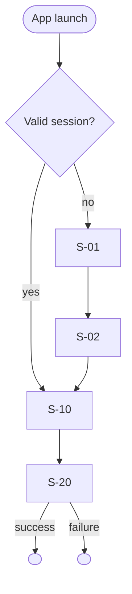

# App flow — <Project name>

Status: Draft · Approved (Gate 2, <YYYY-MM-DD>)

## Flow

## Screen inventory

| ID | Screen | Purpose | Entry points | Exits | Actions | State owner | Repository / API | States | Auth | Accessibility | Platform notes | Compliance |
|---|---|---|---|---|---|---|---|---|---|---|---|---|
| S-01 | <name> | <purpose> | <routes, links> | <destinations> | <actions → outcomes> | <provider / bloc> | <methods / endpoints> | loading · empty · error · offline · success | <none / signed in / role> | <focus, labels, announcements> | <iPad, back behaviour> | <CM rows> |

## Edge flows

| Situation | Behaviour |
|---|---|
| Deep link to a protected screen while signed out | <sign in, then continue to the target> |
| Session expires mid-flow | <preserve input, re-authenticate, resume> |
| Offline at launch | <cached content + notice / first-run message> |
| Permission denied / permanently denied | <explanation, degraded mode, path to Settings> |
| Account deletion | <confirm, delete, sign out, land on Welcome> |
| Update required | <blocking screen with store link> |
